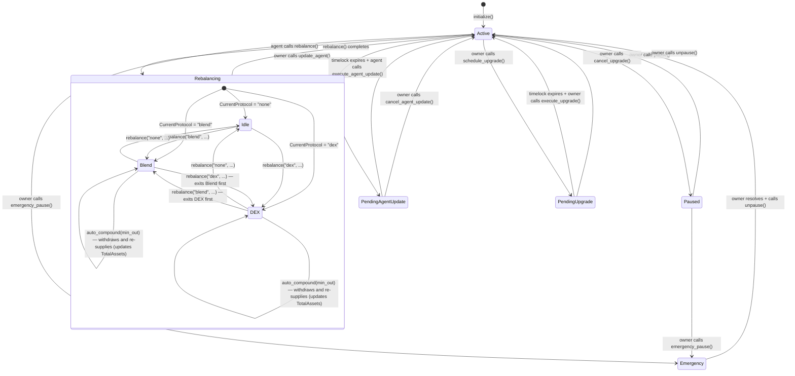
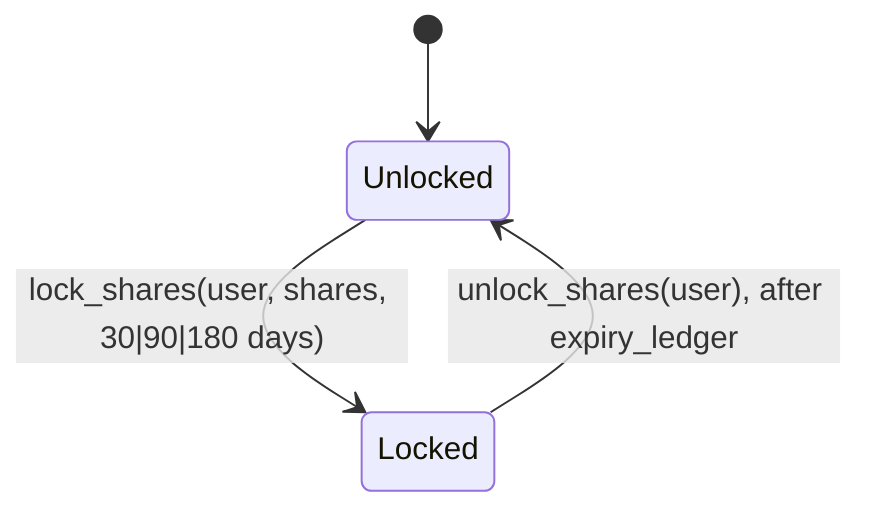
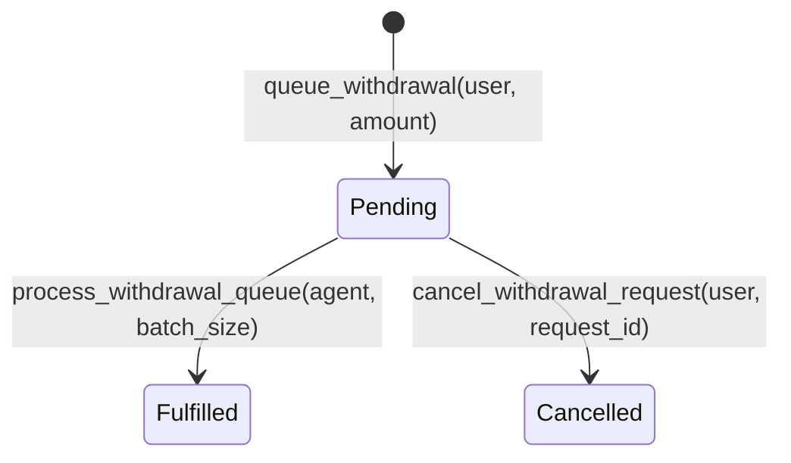
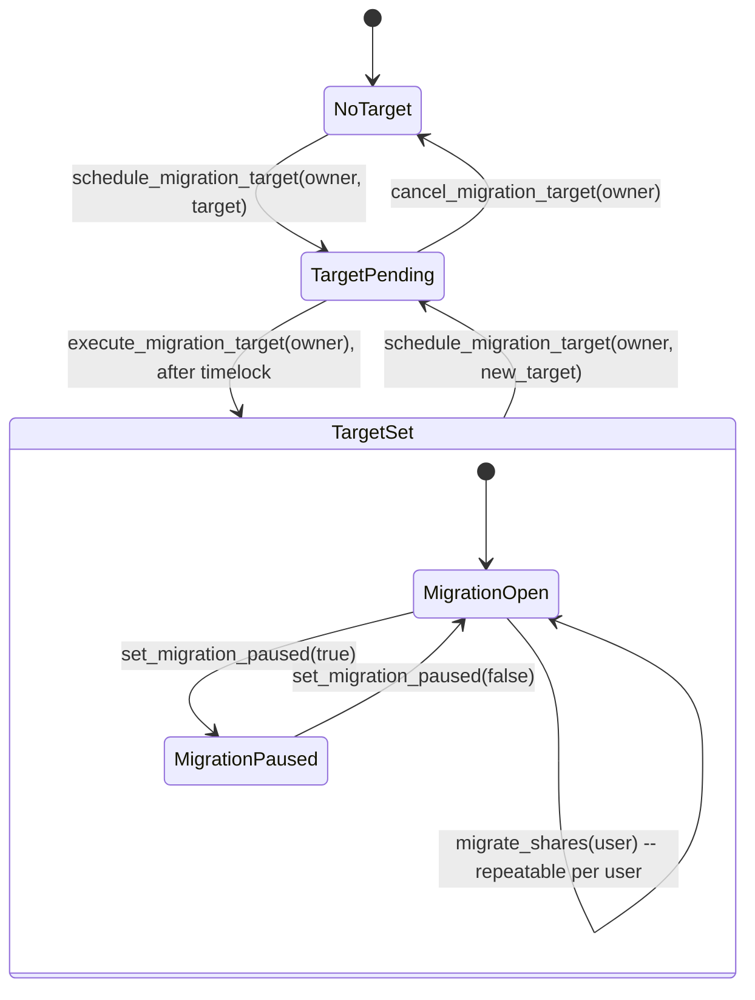
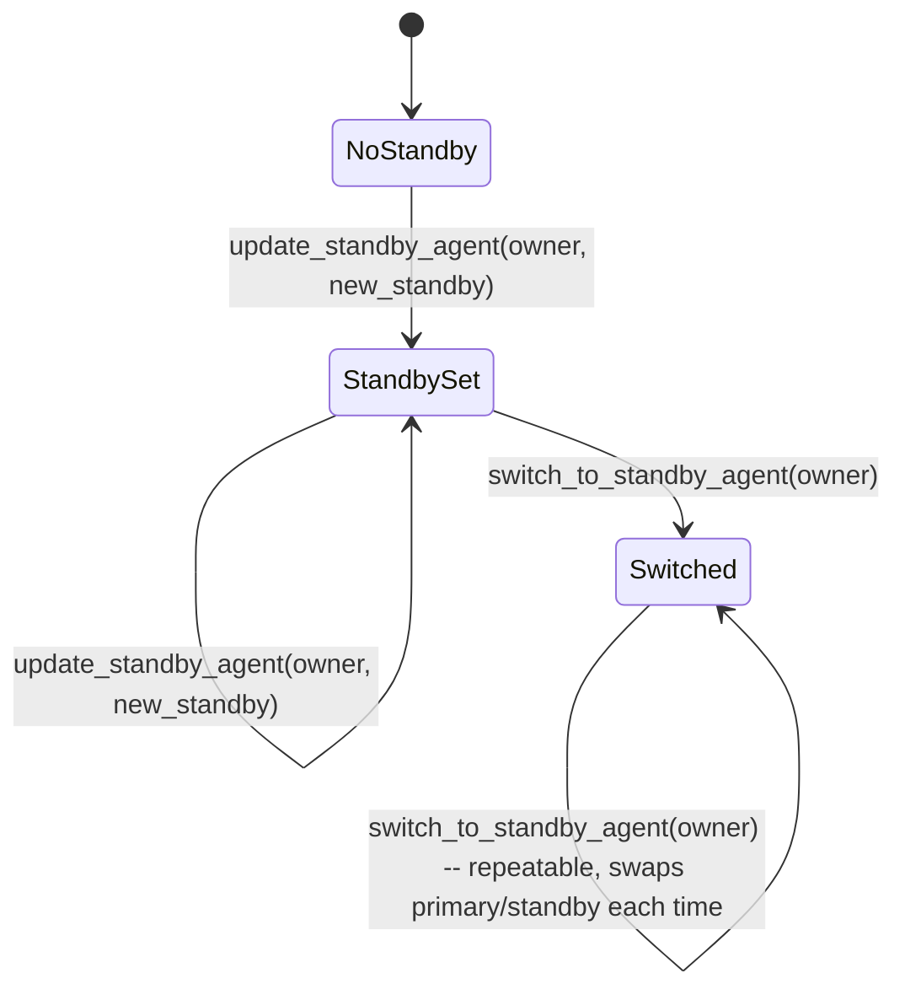
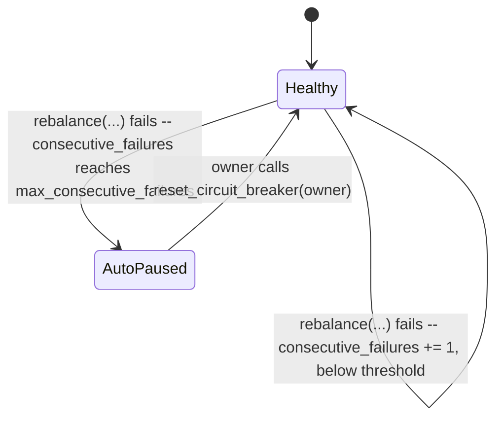

# NeuroWealth Vault — Protocol State Machine

This document describes the lifecycle of the NeuroWealth Vault smart contract,
including all states, transitions, and the actions restricted in each state.

---

## State Diagram

---

## Share Lock / Unlock, Withdrawal Request, Migration and Standby-Agent State Machines

The diagram and table above predate (#636) share locking, (#757) the
withdrawal queue, (#637/#969) vault-to-vault migration, (#653) hot-standby
agent rotation, and (#439) the circuit breaker's auto-pause trip. Each is
documented here, including which functions remain callable while the vault
is paused (`DataKey::Paused`, checked by `require_not_paused`); most of
these flows are **not** gated by the main pause flag at all, which is called
out explicitly below since it's easy to assume otherwise.

### Share locking

| From | To | Trigger | Who | Precondition | Restricted while locked |
|---|---|---|---|---|---|
| Unlocked | Locked | `lock_shares(user, shares, lock_duration_days)` | user | No existing lock (`SharesAlreadyLocked` otherwise); `lock_duration_days` is exactly 30, 90 or 180 (`InvalidLockDuration` otherwise); `shares` ≤ the user's unlocked balance (`InsufficientUnlockedShares` otherwise) | `withdraw`/`withdraw_all` can only touch the user's *unlocked* shares (`burn_and_pay`'s lock-aware floor); `migrate_shares` is blocked outright while any shares are locked, not just for the locked portion (`InsufficientShares`) |
| Locked | Unlocked | `unlock_shares(user)` | user | `current_ledger >= expiry_ledger` (`LockPeriodNotEnded` otherwise) | none |

**Callable while the vault is paused?** Yes for both `lock_shares` and
`unlock_shares`; neither calls `require_not_paused`. A paused vault still
lets a user lock or unlock shares; it is withdrawal/deposit/rebalance that a
pause blocks, not the lock state machine itself.

### Withdrawal request lifecycle (queue)

| From | To | Trigger | Who | Precondition | Notes |
|---|---|---|---|---|---|
| (none) | Pending | `queue_withdrawal(user, amount)` | user | Vault not paused (`require_not_paused`); `amount > 0`; the user's unlocked shares, minus what's already reserved by their other pending requests (`DataKeyExt::ReservedWithdrawalAmount`), cover this request; the queue is below `QueueConfig.max_size` (0 = unlimited) | Assigns the next `DataKeyExt::NextRequestId`, appends to `DataKeyExt::QueueOrder`, and increases the user's `ReservedWithdrawalAmount` so a second `queue_withdrawal` call can't double-spend the same shares (#990) |
| Pending | Fulfilled | `process_withdrawal_queue(agent, batch_size)` | agent | Called by the agent only; processes up to `batch_size` entries in `QueueOrder` FIFO order; a request older than `QueueConfig.ttl` seconds is skipped (left pending) rather than fulfilled | Flips `WithdrawalRequest.fulfilled = true` in place (the entry is never deleted) and removes the ID from `QueueOrder` |
| Pending | Cancelled | `cancel_withdrawal_request(user, request_id)` | user (must be the request's own submitter) | Request exists, is not already fulfilled (`WithdrawalRequestAlreadyFulfilled`) or cancelled (`WithdrawalRequestAlreadyCancelled`) | Flips `WithdrawalRequest.cancelled = true` in place, removes the ID from `QueueOrder`, and decreases the user's `ReservedWithdrawalAmount` |

**Callable while the vault is paused?** `queue_withdrawal` is blocked
(`require_not_paused`); `process_withdrawal_queue` and
`cancel_withdrawal_request` are **not**: an existing pending request can
still be fulfilled or cancelled during a pause, only new requests are
blocked. `set_queue_config` (owner-only, sets `max_size`/`ttl`) is also not
pause-gated.

### Migration (vault-to-vault)

| From | To | Trigger | Who | Precondition |
|---|---|---|---|---|
| NoTarget / TargetSet | TargetPending | `schedule_migration_target(owner, target)` | owner | No timelock already pending (`TimelockAlreadyPending`) |
| TargetPending | TargetSet | `execute_migration_target(owner)` | owner | `current_ledger >= effective_ledger` (`TimelockNotExpired` otherwise); something is actually pending (`NoTimelockPending` otherwise) |
| TargetPending | NoTarget (or back to prior TargetSet) | `cancel_migration_target(owner)` | owner | Something is pending (`NoTimelockPending` otherwise) |
| MigrationOpen | MigrationPaused / MigrationOpen | `set_migration_paused(paused)` | owner | none |
| (user's shares) migrated out | n/a | `migrate_shares(user)` | user | A target is set (`InvalidMigrationTarget` otherwise); migration is not paused (`MigrationPaused` otherwise); user has shares (`NoSharesToMigrate` otherwise); **user has zero locked shares** (`InsufficientShares` otherwise, since migration cannot partially exclude a locked position the way `withdraw` can) |

`migrate_shares` always moves the user's entire unlocked position: it burns
100% of `DataKey::Shares(user)`, transfers the asset-equivalent USDC to
`migration_target`, and calls that contract's `receive_migration` entrypoint
(not its public `deposit`, which would try to pull the funds from `user`'s
wallet a second time, since they already moved vault-to-vault).

**Callable while the vault is paused?** `schedule_migration_target`,
`execute_migration_target`, `cancel_migration_target`, `set_migration_paused`
and `migrate_shares` are all **not** pause-gated; only `migration_paused`
(the migration feature's own independent flag, not the main vault pause)
blocks `migrate_shares`. The *receiving* side is different: `receive_migration`
on the target vault **does** call `require_not_paused`, so a paused target
vault rejects an inbound migration even though the paused source vault would
have happily sent it.

### Hot-standby agent rotation

| From | To | Trigger | Who | Precondition |
|---|---|---|---|---|
| NoStandby / StandbySet | StandbySet | `update_standby_agent(owner, new_standby)` | owner | `new_standby != primary` (`StandbyMatchesPrimaryAgent` otherwise) |
| StandbySet | Switched | `switch_to_standby_agent(owner)` | owner | A standby key is configured (panics otherwise) |

`switch_to_standby_agent` is deliberately timelock-free: the standby becomes
the new primary and the old primary is demoted to standby, instantly, in one
call, the zero-downtime counterpart to the two-step, 24-hour-delayed
`update_agent`/`confirm_agent_update` flow used for the primary agent alone.
Calling it again swaps primary and standby back, so it is safe to call
repeatedly during an incident.

**Callable while the vault is paused?** Yes for both; neither
`update_standby_agent` nor `switch_to_standby_agent` is pause-gated. Agent
key rotation remains available even during an emergency pause, which is the
point: a compromised or lost agent key is exactly the scenario a pause might
be covering.

### Circuit breaker auto-pause and reset

`CircuitBreakerState` is `(max_consecutive_failures, consecutive_failures)`
(one tuple-valued key, to stay within Soroban's `#[contracttype]` variant
cap). `max_consecutive_failures` is owner-configurable via
`set_max_consecutive_failures`; `consecutive_failures` increments on every
`"failed"` rebalance status and resets to 0 on any `"success"`. Reaching the
threshold auto-pauses the vault (sets `DataKey::Paused = true`) the same way
`emergency_pause()` does.

| From | To | Trigger | Who | Precondition |
|---|---|---|---|---|
| Healthy | AutoPaused | `rebalance(...)` internally, once `consecutive_failures >= max_consecutive_failures` | agent (indirectly: the agent didn't ask to pause, a run of failures triggered it) | none |
| AutoPaused | Healthy | `reset_circuit_breaker(owner)` | owner | Caller is the stored owner (`OnlyOwnerCanUnpause` otherwise) |

`reset_circuit_breaker` zeroes `consecutive_failures` and unpauses in the
same call; there is no way to unpause without also resetting the counter, so
an operator can't clear the pause while leaving the vault one failure away
from re-tripping without first addressing why `rebalance` kept failing.

## State Transition Table

| From        | To            | Trigger                        | Who     | Precondition                              | Restricted During Transition         |
|--------------|---------------|--------------------------------------|-----------|----------------------------------------------------------------------------------------------------------------------------------------------------------------------------------------------------------------------------------------------------------------------------------------------------------------------------------------------------------------------------------------------------------------------------------------------------------------------------------------------------------------------------------------------------------------------------------------------------------------------------------------------------------------------------------------------------------------------------------------------------------------------------------------------------------------------------------------------------------------------------------------------------------------------------------------------------------------------------------------------------------------------------------------------------------------------------------------------------------------------------------------------------------------------------------------------------------------------------------------------------------------------------------------------------------------------------------------------------------------------------------------------------------------------------------------------------------------------------------------------------------------------------------------------------------------------------------------------------------------------------------------------------------------------------------------------------------------------------------------------------------------------------------------------------------------------------------------------------------------------------------------------------------------------------------------------------------------------------------------------------------------------------------------------------------------------------------------------------------------------------------------------------------------------------------------------------------------------------------------------------------------------------------------------------------------------------------------------------------------------------------------------------------------------------------------------------------------------------------------------------------------------------------------------------------------------------------------------------------------------------------------------------------------------------------------------------------------------------------------------------------------------------------------------------------------------------------------------------------------------------------------------------------------------------------------------------------------------------------------------------------------------------------------------------------------------------------------------------------------------------------------------------------------------------------------------------------------------------------------------------------------------------------------------------------------------------------------------------------------------------------------------------------------------------------------------------------------------------------------------------------------------------------------------------------------------------------------------------------------------------------------------------------------------------------------------------------------------------------------------------------------------------------------------------------------------------------------------------------------------------------------------------------------------------------------------------------------------------------------------------------------------------------------------------------------------------------------------------------------------------------------------------------------------------------------------------------------------------------------------------------------------------------------------------------------------------------------------------------------------------------------------------------------------------------------------------------------------------------------------------------------------------------------------------------------------------------------------------------------------------------------------------------------------------------------------------------------------------------------------------------------------------------------------------------------------------------------------------------------------------------------------------------------------------------------------------------------------------------------------------------------------------------------------------------------------------------------------------------------------------------------------------------------------------------------------------------------------------------------------------------------------------------------------------------------------------------------------------------------------------------------------------------------------------------------------------------------------------------------------------------------------------------------------------------------------------------------------------------------------------------------------------------------------------------------------------------------------------------------------------------------------------------------------------------------------------------------------------------------------------------------------------------------------------------------------------------------------------------------------------------------------------------------------------------------------------------------------------------------------------------------------------------------------------------------------------------------------------------------------------------------------------------------------------------------------------------------------------------------------------------------------------------------------------------------------------------------------------------------------------------------------------------------------------------------------------------------------------------------------------------------------------------------------------------------------------------------------------------------------------------------------------------------------------------------------------------------------------------------------------------------------------------------------------------------------------------------------------------------------------------------------------------------------------------------------------------------------------------------------------------------------------------------------------------------------------------------------------------------------------------------------------------------------------------------------------------------------------------------------------------------------------------------------------------------------------------------------------------------------------------------------------------------------------------------------------------------------------------------------------------------------------------------------------------------------------------------------------------------------------------------------------------------------------------------------------------------------------------------------------------------------------------------------------------------------------------------------------------------------------------------------------------------------------------------------------------------------------------------------------------------------------------------------------------------------------------------------------------------------------------------------------------------------------------------------------------------------------------------------------------------------------------------------------------------------------------------------------------------------------------------------------------------------------------------------------------------------------------------------------------------------------------------------------------------------------------------------------------------------------------------------------------------------------------------------------------------------------------------------------------------------------------------------------------------------------------------------------------------------------------------------------------------------------------------------------------------------------------------------------------------------------------------------------------------------------------------------------------------------------------------------------------------------------------------------------------------------------------------------------------------------------------------------------------------------------------------------------------------------------------------------------------------------------------------------------------------------------------------------------------------------------------------------------------------------------------------------------------------------------------------------------------------------------------------------------------------------------------------------------------------------------------------------------------------------------------------------------------------------------------------------------------------------------------------------------------------------------------------------------------------------------------------------------------------------------------------------------------------------------------------------------------------------------------------------------------------------------------------------------------------------------------------------------------------------------------------------------------------------------------------------------------------------------------------------------------------------------------------------------------------------------------------------------------------------------------------------------------------------------------------------------------------------------------------------------------------------------------------------------------------------------------------------------------------------------------------------------------------------------------------------------------------------------------------------------------------------------------------------------------------------------------------------------------------------------------------------------------------------------------------------------------------------------------------------------------------------------------------------------------------------------------------------------------------------------------------------------------------------------------------------------------------------------------------------------------------------------------------------------------------------------------------------------------------------------------------------------------------------------------------------------------------------------------------------------------------------------------------------------------------------------------------------------------------------------------------------------------------------------------------------------------------------------------------------------------------------------------------------------------------------------------------------------------------------------------------------------------------------------------------------------------------------------------------------------------------------------------------------------------------------------------------------------------------------------------------------------------------------------------------------------------------------------------------------------------------------------------------------------------------------------------------------------------------------------------------------------------------------------------------------------------------------------------------------------------------------------------------------------------------------------------------------------------------------------------------------------------------------------------------------------------------------------------------------------------------------------------------------------------------------------------------------------------------------------------------------------------------------------------------------------------------------------------------------------------------------------------------------------------------------------------------------------------------------------------------------------------------------------------------------------------------------------------------------------------------------------------------------------------------------------------------------------------------------------------------------------------------------------------------------------------------------------------------------------------------------------------------------------------------------------------------------------------------------------------------------------------------------------------------------------------------------------------------------------------------------------------------------------------------------------------------------------------------------------------------------------------------------------------------------------------------------------------------------------------------------------------------------------------------------------------------------------------------------------------------------------------------------------------------------------------------------------------------------------------------------------------------------------------------------------------------------------------------------------------------------------------------------------------------------------------------------------------------------------------------------------------
